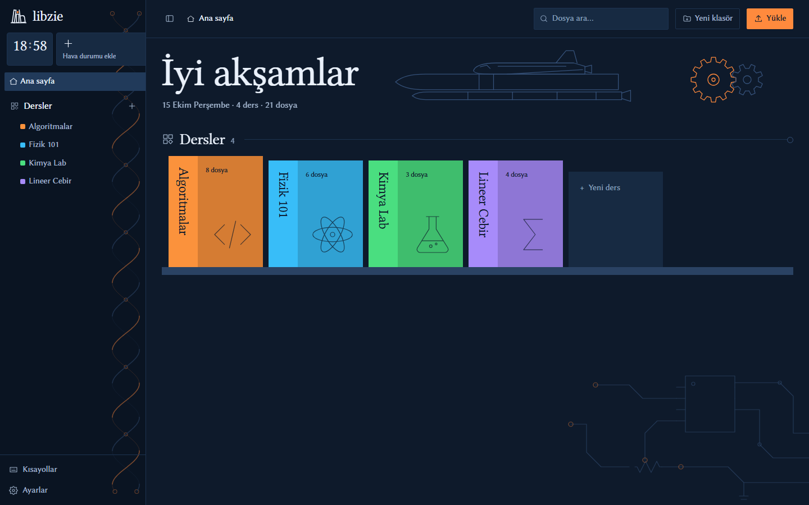
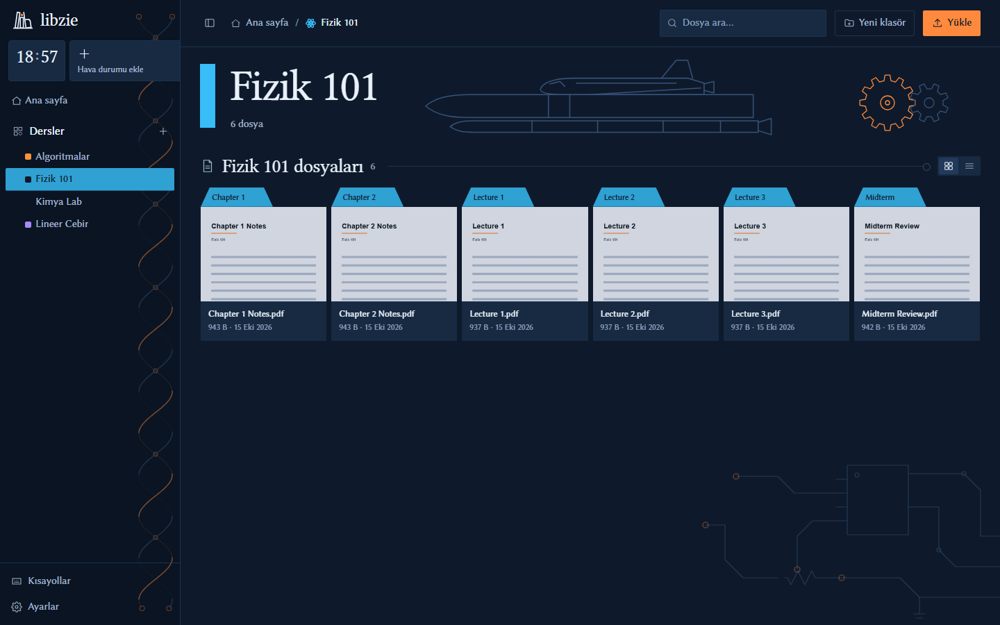

# libzie

[](LICENSE)
[](#kurulum-windows-uygulaması)
[](#kaynak-koddan-çalıştırma-geliştiriciler-için)
[](#kaynak-koddan-çalıştırma-geliştiriciler-için)
[](#gizlilik)

Ders notlarını, slaytları ve PDF'leri derse göre düzenleyen, bilgisayarında yerel çalışan küçük bir arşiv. Dosyalar senin klasörlerinde durur; libzie onları ders karoları, küçük resimler ve sekmeli PDF görüntüleyiciyle gösterir. Hesap, bulut ya da veritabanı yok.

> Arayüz Türkçe ve İngilizcedir (dil Ayarlar'dan seçilir, varsayılan olarak sistem dilini izler). Şimdilik Windows için yazıldı.





*Ekran görüntülerindeki dersler ve dosyalar örnek amaçlı uydurma verilerdir.*

## İçindekiler

- [Özellikler](#özellikler)
- [Kurulum (Windows uygulaması)](#kurulum-windows-uygulaması)
- [Kaynak koddan çalıştırma](#kaynak-koddan-çalıştırma-geliştiriciler-için)
- [Ders klasörün](#ders-klasörün)
- [Güvenlik](#güvenlik)
- [Gizlilik](#gizlilik)
- [Geliştirme](#geliştirme)
- [Yol haritası](#yol-haritası)
- [Lisans](#lisans)

## Özellikler

- Klasörler = dersler: Gezgin'e eklediğin dosya kendiliğinden görünür, içe aktarma yok.
- Her derse renk ve ikon seçebilirsin (fizik, kimya, biyoloji, matematik, edebiyat, müzik… ve elektronik/makine sembolleri): ders menüsünde **Renk seç…** ve **İkon seç…**.
- Sürükle-bırakla yükleme (klasör dahil), taşıma, yeniden adlandırma, "Geri al" ile yumuşak silme.
- PDF'ler sayfa içinde sekmelerde açılır; PDF'lerin ilk sayfası küçük resim olur.
- Türkçe karakterden bağımsız arama (`isletim` → "İşletim"), `Ctrl+K` ile tüm derslerde hızlı arama.
- Tam klavye kullanımı (`?` kısayolları gösterir), `F` ile tam ekran, `Ctrl+B` ile kenar çubuğu.
- Koyu ve açık tema, ya da sistem tercihini izle (Ayarlar → Tema).
- Tamamen çevrimdışı çalışır. İnternete çıkan tek şeyler isteğe bağlı hava durumu (Open-Meteo, şehri sen yazarsın) ve Ayarlar'da Hakkında sekmesini açınca ya da otomatik güncelleme açıkken başlangıçta yapılan sürüm denetimi (GitHub).

## Kurulum (Windows uygulaması)

1. [Releases](https://github.com/nopescope0/libzie/releases) sayfasından en son sürümdeki **libzie-kurulum.exe** dosyasını indir.
2. Çalıştır ve sihirbazı izle (yönetici izni gerekmez, kullanıcıya özel kurulur). Başlat menüsüne kısayol eklenir, istersen masaüstüne de.

Kurulum istemiyorsan **libzie-tasinabilir.exe** tek dosya olarak da var: istediğin klasöre koyup çalıştır (açılışı biraz daha yavaştır).

İlk açılışta Windows "bilgisayarınızı korudu" uyarısı verebilir: uygulama imzasız olduğu için normaldir. **Daha fazla bilgi → Yine de çalıştır**'a tıkla.

### Güncelleme

Yeni sürüm yayınlandığında **Ayarlar → Hakkında** sekmesinde mevcut ve yeni sürüm numarası görünür; **Şimdi güncelle**'ye basınca libzie yeni sürümü indirir, kendini yenileyip yeniden açılır (kurulum sürümü sihirbazı sessizce çalıştırır, taşınabilir sürüm kendi exe'sinin yerine geçer). **Yeni sürümü açılışta otomatik yükle** kutusunu işaretlersen libzie her açılışta bakar ve yeni sürüm varsa kendiliğinden günceller. Dersleriniz ve ayarlarınız güncellemeden etkilenmez. Kaynak koddan çalışırken uygulama içi güncelleme yoktur; `git pull` kullan.

Dersler `Belgeler\libzie\kaynaklar` klasöründe, ayarlar `%APPDATA%\libzie` içinde tutulur; uygulama klasörünü silsen ya da güncellesen de verilerin kalır. Başka bir klasör kullanmak istersen uygulamada **Ayarlar**'dan seç. Uygulama Windows'taki Edge WebView2 bileşenini kullanır (Windows 10/11'de genellikle hazır gelir).

## Kaynak koddan çalıştırma (geliştiriciler için)

[Python 3](https://www.python.org/downloads/) kurulu olmalı. Başka bir şey gerekmez (bağımlılık ve derleme yok).

```
git clone https://github.com/nopescope0/libzie.git
cd libzie
python server.py
```

Tarayıcıda `http://127.0.0.1:8765` açılır. Sunucu yalnızca kendi bilgisayarına bağlanır, ağdan erişilemez. Bu yolda dersler proje içindeki `kaynaklar/` klasöründe durur.

Seçenekler:

- `python server.py --no-browser`: tarayıcıyı otomatik açma.
- `$env:PORT=9000` (PowerShell) ya da `set PORT=9000` (cmd), sonra `python server.py`: başka bir port kullan.

## Ders klasörün

Kaynak koddan çalıştırırken dosyalar varsayılan olarak `kaynaklar/` klasöründe tutulur (git'e girmez); uygulamada `Belgeler\libzie\kaynaklar`. Başka bir klasör kullanmak istersen uygulamada **Ayarlar**'dan seç, örneğin not aldığın uygulamanın Google Drive yedek klasörü. Bu, `ayarlar.json` dosyasına yazılır (örnek: `ayarlar.ornek.json`). `KAYNAK_KLASORU` ortam değişkeni de aynı işi yapar ve Ayarlar penceresini kilitler.

## Güvenlik

Sunucu yalnızca `127.0.0.1`'e bağlıdır ve her istek, yalnızca senin hesabının okuyabildiği bir oturum anahtarıyla doğrulanır; başka web siteleri ya da başka programlar libzie'yi kullanamaz. "Varsayılan uygulamada aç" `.exe`/`.bat` gibi çalıştırılabilir dosyaları açmaz, klasörüne düşen zararlı bir SVG/HTML dosyası betik çalıştıramaz. Uygulama **kod imzalı değildir**; yalnızca bu deponun [Releases](https://github.com/nopescope0/libzie/releases) sayfasından indir ve istersen `SHA256SUMS.txt` ile doğrula. Ayrıntılar ve açık bildirimi için [SECURITY.md](SECURITY.md).

## Gizlilik

Dosyaların bilgisayarından çıkmaz. Sunucu yalnızca `127.0.0.1`'e bağlıdır. Hava durumu açıksa şehir adın Open-Meteo'ya gider; istemezsen şehir girme. Sürüm denetimi yalnızca GitHub'a "son sürüm nedir" diye sorar, hiçbir kişisel veri göndermez.

## Geliştirme

Windows uygulaması `app.py` (pywebview) ve `.github/workflows/windows.yml` ile derlenir. Mimari ve kurallar için [CLAUDE.md](CLAUDE.md), ürün bağlamı için [PRODUCT.md](docs/PRODUCT.md), görsel sistem için [DESIGN.md](docs/DESIGN.md) dosyalarına bak. Sunucu Python standart kütüphanesiyle, arayüz tek bir `static/index.html` dosyasıyla yazılmıştır.

## Yol haritası

Planlanan ve düşünülen özellikler için [ROADMAP.md](docs/ROADMAP.md) dosyasına bak. Fikir ve geri bildirimini issue olarak açabilirsin.

## Lisans

[MIT](LICENSE). pdf.js (Apache-2.0) ve Linux Libertine/Biolinum (SIL OFL 1.1) kendi lisanslarıyla pakete dahildir (`static/vendor/` içinde lisans metinleri var).
